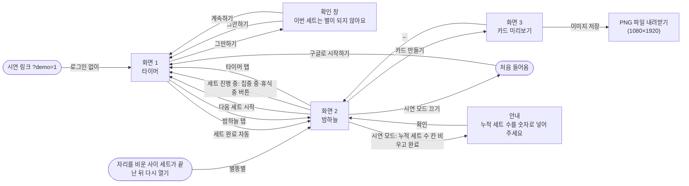
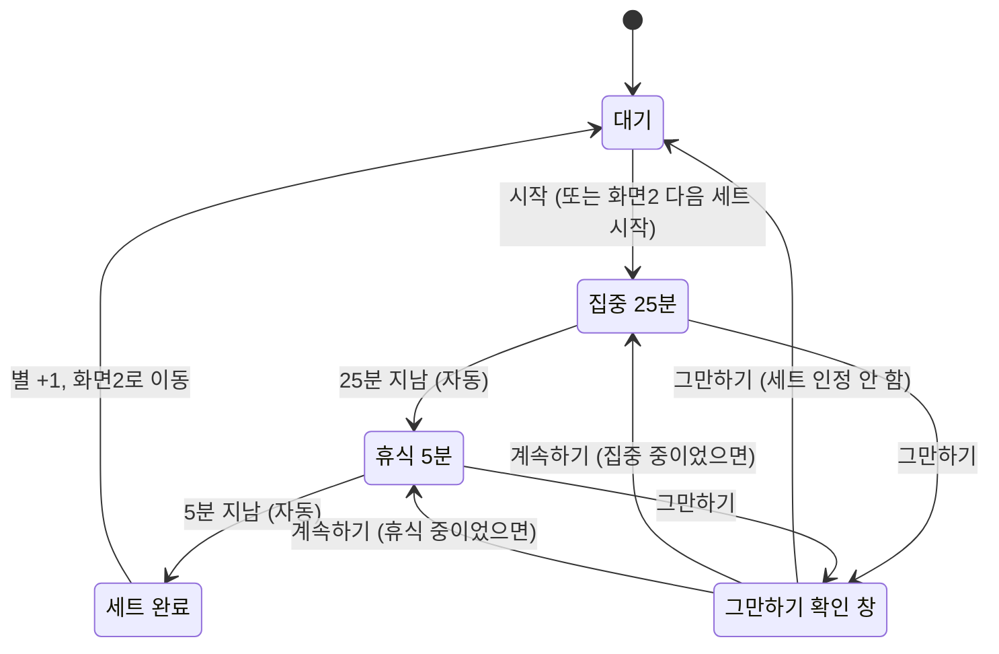

# PRD — 타이머

- 상태 : 초안
- 한 줄 정의 : 별도로 — 퇴근 후 자기계발을 하는 직장인을 위한 뽀모도로 타이머.

## 1. 문제

### 배경
- 문제: 뽀모도로(포커스) 타이머는 집중·휴식 한 세트가 지나면 그냥 끝난다. 사용자는 세트를 반복하지만 그 과정에 재미나 흥미가 없고, 혼자 쓰고 끝나서 쌓인 결과를 보여주거나 이어갈 동기가 없다. **(가설 — 미검증)** (topic.md 문제 정의)
- 누가 겪는가: 퇴근 후 공부 등 자기계발에 집중하고, 이미 뽀모도로(포커스) 타이머를 쓰고 있는 직장인. (topic.md 타겟 사용자)
- 근거 자료: 문제 정의("재미가 없다", "혼자 쓰고 끝난다")를 뒷받침할 설문·인터뷰 자료는 아직 없다. (topic.md 확인할 점)
- 비슷한 서비스: 집중하면 나무가 자라 숲이 되는 Forest(Seekrtime), 별·우주 소재의 뽀모도로 앱(Focus Orbit, Momentum, Star Focus). 소재 자체는 차별점이 아니며, Forest에 비슷한 기능이 있는지는 최신 버전으로 확인이 필요하다. (topic.md 성장 소재·움직임·차별점)
- 차별점: 집중만이 아니라 휴식까지 마친 한 세트가 성장 단위다 — "휴식까지 마쳐야 별이 뜬다". (topic.md 차별점)

### 목표
- 핵심 가설: "반복한 세트가 밤하늘의 별로 쌓여 눈에 보이고 남에게 보여줄 수 있으면, 사용자는 세트를 더 오래·자주 반복한다." (topic.md 문제 정의)
- 1라운드에서 검증할 가장 위험한 가정: "마친 세트가 밤하늘의 별로 쌓여 보이면, 세트를 반복할 동기가 생긴다." (scope.md)
- 판정 지표(초안): ① 여러 날에 걸쳐 세트를 완료한 사람 수(재방문) ② 한 사람이 하루에 완료한 세트 수 ③ 그만하기 비율 ④ 카드를 저장한 사람 수. 판정은 과정이 끝난 뒤(11월 이후)에 한다. (scope.md)
- 판정 기준 숫자, 테스터 인원·기간: (질문 필요)
- 비교 기준: 핵심 가설은 "더 오래·자주 반복한다"인데, 판정 지표는 모두 별도로 안에서만 잰다. 테스터는 이미 다른 뽀모도로 타이머를 쓰고 있으므로, 지금 하루에 몇 세트를 하는지 같은 비교 기준이 없으면 "더"인지 판단할 수 없다. 모집 때 지금 사용량을 물어볼지: (질문 필요) (topic.md 핵심 가설·타겟 사용자, scope.md 판정 지표를 맞춰 보며 발견)
- 측정 한계: ④ 카드 저장은 화면3에서 "이미지 저장"을 눌러 PNG 파일을 내려받은 것까지만 알 수 있고, 그 파일을 SNS에 올렸는지는 알 수 없다. 캡처 안내 경로는 안내를 띄운 것까지만 기록된다. PC에서 내려받은 카드를 SNS에 올리려면 휴대폰으로 옮겨야 하므로 ④가 휴대폰으로 만들 때보다 낮게 나올 수 있다. (scope.md, 2026-10-20 결정: PC 전용)
- 브라우저에 저장된 별은 사이트 데이터를 지우거나, 맥 사파리처럼 7일 넘게 열지 않은 사이트의 기록을 지우는 브라우저에서는 사라질 수 있다. 판정 숫자는 Supabase에 쌓인 기록(누적 세트 수·이벤트)으로 세므로 잃지 않는다. 브라우저 기록이 비어 있어도 같은 구글 계정으로 다시 로그인하면, Supabase에서 그 계정의 누적 세트 수를 불러와 별을 되살린다. (scope.md 보류 항목, 2026-10-20 결정: PC 전용, 2026-10-27 결정: 구글 로그인)
- 일정: 1라운드 = MVP 제작 교육 과정(개발 회차 2026-10-06 시작, 첫 배포 10/30, 고친 것 반영·구글 로그인 11/3, 과정 종료·조원 시험 11/5). (scope.md, 2026-10-27 교육과정 일정)
- 개발 시간·예산 상한: (질문 필요)

## 2. 사용자

### 페르소나
- 퇴근 후 공부 등 자기계발에 집중하고, 이미 뽀모도로(포커스) 타이머를 쓰고 있는 직장인. (topic.md 타겟 사용자)
- 쓰는 시간대는 퇴근 후 저녁. 예상 기간 계산에서는 하루 저녁 4세트(2시간)를 한다고 가정했다. (topic.md 성장 소재·별 단계)
- 제외 대상: (질문 필요)
- 테스터 모집 조건: (질문 필요)

### 사용자 스토리
- 퇴근 후 자기계발을 하는 직장인으로서, 원형 타이머로 집중 25분과 휴식 5분이 줄어드는 것을 눈으로 보며 한 세트를 끝까지 마치고 싶다. 시간이 줄어드는 게 보이고, 휴식까지 마쳐야 한 세트라는 것을 알 수 있기 때문이다. (topic.md 타이머 표시)
- 퇴근 후 자기계발을 하는 직장인으로서, 마친 세트가 밤하늘의 별로 쌓이고 커지는 것을 보고 싶다. 세트를 반복하는 과정에 재미가 없고 쌓인 결과가 보이지 않기 때문이다. (topic.md 문제 정의)
- 퇴근 후 자기계발을 하는 직장인으로서, 내 밤하늘을 이미지 카드 파일로 PC에 저장하고 싶다. 혼자 쓰고 끝나지 않고, 쌓인 결과를 SNS에 올려 남에게 보여주기 위해서다. (topic.md 문제 정의·핵심 컨셉, 2026-10-20 결정: PC 전용)

## 3. 범위

### 넣을 기능
1. 뽀모도로 타이머 — 화면1. 집중 25분 + 휴식 5분 고정, 원형 타이머, 세트 동안 화면 켜 두기, "그만하기" 확인 창. "휴식까지 마쳐야 별이 뜬다"를 직접 구현하는 타협 불가 1순위. (scope.md)
2. 밤하늘 화면 — 화면2. 세트마다 별이 뜨고 10개씩 모이면 한 단계 큰 별로 합쳐짐(작은별 → 중간별 → 큰별 → 대왕별), 반짝임·별똥별·합쳐지는 연출. 가장 위험한 가정을 검증하는 화면. (scope.md)
3. 이미지 카드 저장 — 화면3. 9:16 카드를 PNG 이미지 파일로 PC에 내려받기. 세 기능 중 우선순위가 가장 낮음. (scope.md, 2026-10-20 결정: PC 전용)

- 구현 필수 조건(기능이 아니라 위 3가지를 측정·시연할 수 있게 만드는 전제): PC 브라우저 전용, 구글 계정 로그인(시연 링크는 로그인 없이), 기록은 브라우저에 저장하고 계정 번호와 함께 Supabase에도 보내며, 브라우저 기록이 지워졌거나 다른 브라우저·PC여도 같은 계정으로 로그인하면 Supabase에서 다시 불러온다, 화면에는 내 계정의 기록만 보인다, Supabase `event_log` 표에 이벤트 4개(세트 시작·세트 완료·그만하기·카드 저장)를 날짜·시각·계정 번호·이벤트로 기록(시연 모드는 기록하지 않음), 시연 모드(`…/?demo=1` 시연 링크로만 켬, 집중 1분 + 휴식 12초, 누적 세트 수 바꾸기). (scope.md, 2026-10-20 결정: PC 전용·이벤트는 Supabase 표, 2026-10-27 결정: 구글 로그인·시연 모드는 시연 링크로만)

### 기능 요구사항
1. 화면1에서 "시작"을 누르면 원형 타이머(한 바퀴 = 한 세트 30분, 12시 옆 휴식 조각 60° + 집중 조각 300°)가 12시 쪽으로 줄어들며 집중 25분 → 휴식 5분이 버튼 없이 이어지고, 휴식이 끝나면 세트 완료로 화면2로 넘어간다 — 세트 동안 화면이 자동으로 꺼지지 않고, 화면이 켜져 있으면 집중이 끝날 때와 세트가 끝날 때 소리가 나며, 남은 시간은 시작 시각 기준으로 계산하고, 도중에 "그만하기"를 누르면 확인 창("이번 세트는 별이 되지 않아요")에서 "그만하기"는 세트를 인정하지 않고 대기로, "계속하기"는 하던 집중·휴식으로 돌아간다(일시정지·휴식 건너뛰기 없음). 대기 상태에서는 0세트면 안내 한 줄, 1세트 이상이면 "누적 N세트"가 보인다. (scope.md, flow.md)
2. 세트를 마치면 화면2 밤하늘에 별똥별이 떨어져 새 작은별이 박히고, 작은별 10개가 모이면 중간별 1개로 합쳐지며(중간별 10개 → 큰별, 큰별 10개 → 대왕별), 누적 세트 수와 총 집중 시간(끝까지 마친 세트 × 25분)이 보이고, "다음 세트 시작"을 누르면 화면1에서 바로 집중이 시작된다 — 0세트면 빈 밤하늘과 "첫 세트를 마치면 별이 떠요"가 보이고, 별은 늘 은은하게 반짝이며, 컴퓨터의 "동작 줄이기" 설정(윈도우: 애니메이션 효과 끄기, 맥: 동작 줄이기)이 켜져 있으면 움직임을 줄인다. 세트가 진행 중일 때 밤하늘 탭으로 오면 "다음 세트 시작" 대신 "집중 중 · 12:30 남음"(휴식 중이면 "휴식 중 · 04:30 남음")이 보이고 누르면 진행 중인 화면1로 돌아가며, 자리를 비운 사이 세트가 끝났으면 다시 열 때 화면2로 들어와 별똥별이 떨어진다. (scope.md, flow.md, 2026-10-20 결정: PC 전용)
3. 화면2에서 "카드 만들기"를 누르면 화면3에 9:16(1080×1920px) 카드(밤하늘, 누적 세트 수, 총 집중 시간, "별도로")가 보이고, "이미지 저장"을 누르면 카드가 1080×1920px PNG 파일로 PC에 내려받아진다 — 0세트면 "카드 만들기"를 누를 수 없다. (scope.md, flow.md, 2026-10-20 결정: PC 전용)

### 비목표
- 회원가입 화면·비밀번호 로그인 — 까닭: 구글 계정 로그인 하나로 충분하다. (2026-10-27 결정: 구글 로그인)

- 일시정지 — 까닭: "멈추면 인정 안 함" 규칙과 어긋난다. (scope.md)
- 휴식 건너뛰기 버튼 — 까닭: "휴식까지 마쳐야 별이 뜬다"는 차별점과 어긋난다. (scope.md)
- 친구·랭킹·소셜 피드 — 까닭: 공유는 카드 이미지 내려받기까지만 하고, SNS에는 사용자가 직접 올린다. (scope.md, 2026-10-20 결정: PC 전용)
- SNS 직접 올리기 연동(인스타그램 등) — 까닭: 위 항목과 같이 공유는 카드 이미지 내려받기까지만 하고, SNS에는 사용자가 직접 올린다. (scope.md 친구·랭킹·소셜 피드 항목의 까닭, 2026-10-20 결정: PC 전용)
- 통계 화면(날짜별·주별 그래프) — 까닭: 누적 세트 수와 총 집중 시간만 보여준다. (scope.md)
- 기록 초기화·삭제 화면 — 까닭: 1라운드에서는 PC 브라우저 설정의 사이트 데이터 지우기로 대신한다(전부 지우기만 가능, Supabase에 쌓인 누적 세트 수와 이벤트 기록은 남아서 다시 로그인하면 별이 되살아남). (2026-10-20 결정: PC 전용)
- 네이티브 앱(iOS/안드로이드 스토어 배포) — 까닭: (질문 필요). 1라운드는 웹으로 만들기로 했다는 결정만 있다. (topic.md 운영 형태)
- 결제 — 까닭: (질문 필요)
- 휴대폰 화면 지원(휴대폰 브라우저 화면 맞춤, 공유 시트, 사진첩 저장) — 까닭: 1라운드(교육과정)는 일정에 맞춰 PC 브라우저로만 만든다. (2026-10-20 결정)

## 4. 화면

### 사용자 흐름
- 핵심 흐름: 처음 들어옴 → "구글로 시작하기" → 화면1 "시작" → 집중 25분 → 휴식 5분(자동) → 화면2 밤하늘에 새 별 → "다음 세트 시작"으로 반복, 또는 "카드 만들기" → 화면3 → "이미지 저장"으로 PC에 내려받기 (flow.md, 2026-10-20 결정: PC 전용, 2026-10-27 결정: 구글 로그인)
- 화면 1 (타이머): 원형 타이머로 집중·휴식 한 세트를 돌리며 "시작"과 "그만하기"를 누르는 화면. 로그인하지 않았으면 이 화면에 "구글로 시작하기"가 먼저 보이고, 로그인하면 대기 상태에서 시작한다. 시연 링크는 로그인 없이 대기 상태에서 시작한다. 세트가 진행 중일 때 다시 열면 이 화면에서 남은 시간을 이어 보여준다. 대기 상태에서 "?" 단추를 누르면 뽀모도로 타이머 설명("25분 집중과 5분 휴식을 반복하여 집중력을 높이는 시간 관리 도구")이 열린다.
- 화면 2 (밤하늘): 마친 세트가 별로 쌓인 밤하늘과 누적 세트 수·총 집중 시간을 보여주고 "다음 세트 시작"과 "카드 만들기"를 누르는 화면. 시연 모드는 시연 링크(`…/?demo=1`)로만 켜고, 시연 중에는 누적 세트 수를 바꾸는 칸(D-1)과 "시연 모드 끄기" 단추가 붙는다. 자리를 비운 사이 세트가 끝났으면 다시 열 때 이 화면으로 들어온다. (2026-10-27 결정: 시연 모드는 시연 링크로만)
- 화면 3 (카드 미리보기): 9:16 카드를 미리 보고 "이미지 저장"을 눌러 PNG 파일로 내려받는 화면.
- 창·안내: 그만하기 확인 창(1-D), "누적 세트 수를 숫자로 넣어 주세요" 안내(시연 모드), 뽀모도로 타이머 설명 상자(1-A의 "?" 단추).
- 와이어프레임: idea/Wireframe.png. 프레임 1-A~1-E(타이머), 2-A~2-D(밤하늘), 3-A~3-C(카드, 3-B는 PC 전용 결정으로 쓰지 않음, 3-C는 선택), D-1·D-1E(시연 모드), 별 크기 범례. 위 흐름의 화면·창·안내가 모두 들어 있다. "구글로 시작하기"와 "시연 모드 끄기" 단추는 와이어프레임에는 없다. (flow.md)

화면1 안에서 바뀌는 상태 (flow.md "화면 1 타이머 — 상태 흐름"):

## 5. 완성 기준

### 수용 기준
- [ ] 제3자 1명이 PC에서 설명 없이 첫 세트를 시작해 끝까지 마치고, 밤하늘에서 새 별을 확인한 뒤 카드 이미지를 PC에 내려받는다. 일정이 밀려 카드 기능을 캡처 안내로 줄인 경우에는 안내를 보고 카드 화면을 캡처해 저장하는 것까지로 본다. (scope.md 완료 기준 초안, 카드 기능 축소 결정과 맞춤, 2026-10-20 결정: PC 전용)
- [ ] 처음 들어오면 화면1에 "구글로 시작하기"가 보이고, 구글로 로그인하면 화면1 대기가 보이며, 0세트면 "25분 집중하고 5분 쉬면 밤하늘에 별이 떠요"가 보인다. 시연 링크(`…/?demo=1`)는 로그인 없이 화면1 대기가 먼저 보인다. (flow.md, 2026-10-27 결정: 구글 로그인)
- [ ] "시작"을 누르면 원형 타이머가 12시 쪽으로 줄어들고, 집중 25분이 끝나면 버튼 없이 휴식 5분이 시작되며, 휴식이 끝나면 밤하늘로 자동 이동한다. (scope.md, flow.md)
- [ ] 집중·휴식 중 "그만하기"를 누르면 확인 창이 뜨고, 창에서 "그만하기"를 누르면 그 세트는 별이 되지 않고 화면1 대기로, "계속하기"를 누르면 하던 집중이나 휴식으로 돌아간다. (flow.md)
- [ ] 다른 탭에 갔다 오거나 화면이 꺼졌다 켜져도 남은 시간이 맞게 보이고, 세트 시간이 지난 뒤 돌아오면 세트로 인정된다. (scope.md, flow.md)
- [ ] 세트 동안(집중·휴식) 화면이 자동으로 꺼지지 않고, 화면이 켜져 있으면 집중이 끝날 때와 세트가 끝날 때 소리가 난다. (scope.md)
- [ ] 10번째 세트를 마치면 작은별 10개가 중간별 1개로 합쳐지고, 23세트에서는 중간별 2개 + 작은별 3개가 보인다. (topic.md)
- [ ] 세트를 마치고 밤하늘로 넘어오면 별똥별이 떨어져 새 별 자리에 박히고, 별들은 늘 은은하게 반짝이며, 컴퓨터의 "동작 줄이기" 설정(윈도우: 애니메이션 효과 끄기, 맥: 동작 줄이기)이 켜져 있으면 움직임이 줄어든다. (scope.md, 2026-10-20 결정: PC 전용)
- [ ] 누적 세트 수와 총 집중 시간이 끝까지 마친 세트 × 25분으로 보이고, 멈춘 세트의 시간은 더해지지 않는다. (topic.md)
- [ ] 0세트일 때 화면2에 빈 밤하늘과 "첫 세트를 마치면 별이 떠요"가 보이고, "카드 만들기"는 눌리지 않는다. (flow.md)
- [ ] 화면2에서 "다음 세트 시작"을 누르면 화면1로 가면서 바로 집중 25분이 시작된다. (flow.md)
- [ ] 세트가 진행 중일 때 밤하늘 탭으로 가면 "다음 세트 시작"이 보이지 않고 "집중 중 · 남은 시간"(휴식 중이면 "휴식 중 · 남은 시간") 버튼이 보이며, 누르면 진행 중인 화면1로 돌아간다. 이때 새 세트는 시작되지 않는다. (flow.md)
- [ ] 1세트 이상일 때 화면1 대기에 안내 한 줄 대신 "누적 N세트"가 보인다. (flow.md)
- [ ] 세트 도중 탭을 닫았다가 세트가 끝난 뒤 다시 열면 화면2로 들어와 별똥별이 떨어지고 누적 세트 수가 1 늘어 있다. 세트 도중에 다시 열면 화면1에서 남은 시간이 이어진다. (flow.md)
- [ ] "카드 만들기"를 누르면 화면3에 9:16(1080×1920px) 카드가 보이고, 카드에 밤하늘, 누적 세트 수, 총 집중 시간, "별도로"가 들어 있으며, ←를 누르면 화면2로 돌아온다. (topic.md, scope.md, flow.md)
- [ ] "이미지 저장"을 누르면 카드가 1080×1920px PNG 파일로 PC에 내려받아지고, 화면3은 그대로 남는다. (flow.md, 2026-10-20 결정: PC 전용)
- [ ] 세트를 완료하면 누적 세트 수가 계정 번호와 함께 Supabase에 저장되어, Supabase 관리 화면에서 확인할 수 있다. 브라우저 기록을 지우거나 다른 브라우저에서 같은 구글 계정으로 로그인하면 누적 세트 수가 되살아나고, 다른 계정의 기록은 보이지 않는다. (2026-10-27 결정: 구글 로그인)
- [ ] Supabase `event_log` 표에 세트 시작·세트 완료·그만하기·카드 저장 이벤트가 날짜·시각·계정 번호와 함께 기록된다. (scope.md, 2026-10-20 결정: 이벤트는 Supabase 표, 2026-10-27 결정: 구글 로그인)
- [ ] 시연 링크(`…/?demo=1`)로 들어오면 로그인 없이 시연 모드가 켜지고, 세트가 집중 1분 + 휴식 12초로 돌고, 누적 세트 수를 "9", "23", "150", "1000" 등으로 바꿀 수 있으며, "시연 모드 끄기"를 누르면 시연 모드가 꺼지고, 시연 기록은 실제 기록·분석 이벤트와 섞이지 않는다. (scope.md, flow.md, 2026-10-27 결정: 시연 모드는 시연 링크로만)
- [ ] 시연 모드에서 누적 세트 수 칸을 비우거나 숫자가 아닌 값을 넣고 "완료"를 누르면 "누적 세트 수를 숫자로 넣어 주세요" 안내가 뜨고, "확인" 후 D-1로 돌아온다. (flow.md)
- 의도적으로 허용하는 미완성: 일정이 밀리면 카드 이미지 내려받기 대신 "화면을 캡처해 저장하세요" 안내로 줄일 수 있다. (scope.md) 그 밖에 허용하는 미완성과 허용하지 않는 것: (질문 필요)
- 사업 판정(계속·수정·중단) 기준은 "1. 문제 > 목표" 참조.