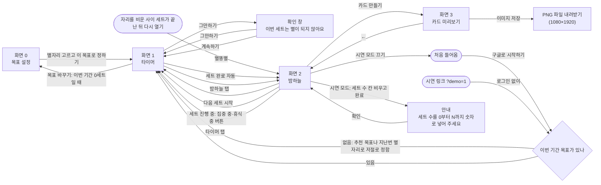
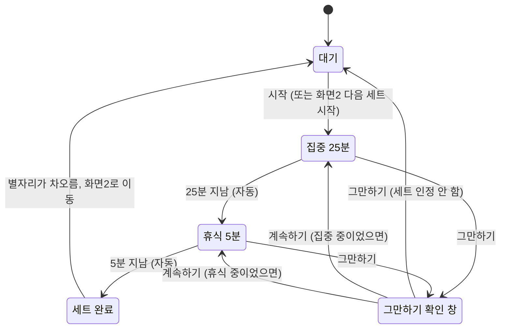

# PRD — 타이머

- 상태 : 초안
- 판 : 5판 (2026-10-30, 첫 화면을 타이머로 — 처음에는 추천 목표(오리온자리 하루 3세트)가 저절로 정해져 바로 시작하고, 다른 별자리는 "목표 바꾸기"로 고름 · 별자리 규칙 B안 · 무료 버전 별자리 5개 · 이름 별모도로)
- 한 줄 정의 : 별모도로 — 퇴근 후 자기계발을 하는 직장인을 위한, 별자리를 완성하는 집중 타이머(뽀모도로).

## 1. 문제

### 배경
- 문제: 뽀모도로(포커스) 타이머는 집중·휴식 한 세트가 지나면 그냥 끝난다. 사용자는 세트를 반복하지만 그 과정에 재미나 흥미가 없고, 혼자 쓰고 끝나서 쌓인 결과를 보여주거나 이어갈 동기가 없다. 결과가 쌓이기만 하고 끝이 없으면, 오늘 몇 세트를 할지 정할 이유도 결과를 보여줄 뚜렷한 순간도 없다. **(가설 — 미검증)** (topic.md 문제 정의, 2026-10-28 결정: 목표 별자리)
- 누가 겪는가: 퇴근 후 공부 등 자기계발에 집중하고, 이미 뽀모도로(포커스) 타이머를 쓰고 있는 직장인. (topic.md 타겟 사용자)
- 근거 자료: 문제 정의("재미가 없다", "혼자 쓰고 끝난다")를 뒷받침할 설문·인터뷰 자료는 아직 없다. (topic.md 확인할 점)
- 비슷한 서비스: 집중하면 나무가 자라 숲이 되는 Forest(Seekrtime), 별·우주 소재의 뽀모도로 앱(Focus Orbit, Momentum, Star Focus). 소재 자체는 차별점이 아니며, Forest에 비슷한 기능이 있는지는 최신 버전으로 확인이 필요하다. (topic.md 성장 소재·움직임·차별점)
- 차별점: 집중만이 아니라 휴식까지 마친 한 세트가 성장 단위다 — "휴식까지 마쳐야 별이 뜬다". 목표 별자리(처음에는 추천 목표가 저절로 정해지고, 원하면 바꿈)가 마친 세트만큼 앞 별부터 차오르고, 목표를 채우면 별자리가 완성된다. (topic.md 차별점, 2026-10-29 결정: 별자리 규칙 B안·별자리 5개 중 고르기, 2026-10-30 결정: 추천 목표로 바로 시작)

### 목표
- 핵심 가설: "별자리 목표가 있고(처음에는 추천 목표가 저절로 정해지고, 원하면 바꿀 수 있음), 마친 세트만큼 별자리가 차올라 완성되는 것이 눈에 보이고 남에게 보여줄 수 있으면, 사용자는 세트를 더 오래·자주 반복한다." (topic.md 문제 정의, 2026-10-29 결정: 별자리 규칙 B안·별자리 5개 중 고르기, 2026-10-30 결정: 추천 목표로 바로 시작)
- 1라운드에서 검증할 가장 위험한 가정: "별자리 목표가 있고 마친 세트마다 별자리가 차오르는 것을 보면, 목표를 채울 때까지(그 뒤에도) 세트를 반복할 동기가 생긴다." (scope.md, 2026-10-29 결정: 별자리 규칙 B안·별자리 5개 중 고르기, 2026-10-30 결정: 추천 목표로 바로 시작)
- 판정 지표(초안): ① 여러 날에 걸쳐 세트를 완료한 사람 수(재방문) ② 한 사람이 하루에 완료한 세트 수 ③ 그만하기 비율 ④ 카드를 저장한 사람 수 ⑤ 목표 달성률(세트를 한 번 이상 한 기간 가운데 별자리를 완성한 기간의 비율) ⑥ 목표를 채운 뒤에도 세트를 더 한 사람 수(덤 별). ⑤·⑥은 Supabase 목표 표로 센다. 판정은 과정이 끝난 뒤(11월 이후)에 한다. (scope.md, 2026-10-29 결정: 별자리 규칙 B안)
- 판정 기준 숫자, 테스터 인원·기간: (질문 필요)
- 비교 기준: 핵심 가설은 "더 오래·자주 반복한다"인데, 판정 지표는 모두 별모도로 안에서만 잰다. 테스터는 이미 다른 뽀모도로 타이머를 쓰고 있으므로, 지금 하루에 몇 세트를 하는지 같은 비교 기준이 없으면 "더"인지 판단할 수 없다. 모집 때 지금 사용량을 물어볼지: (질문 필요) (topic.md 핵심 가설·타겟 사용자, scope.md 판정 지표를 맞춰 보며 발견)
- 측정 한계: ④ 카드 저장은 화면3에서 "이미지 저장"을 눌러 PNG 파일을 내려받은 것까지만 알 수 있고, 그 파일을 SNS에 올렸는지는 알 수 없다. 캡처 안내 경로는 안내를 띄운 것까지만 기록된다. PC에서 내려받은 카드를 SNS에 올리려면 휴대폰으로 옮겨야 하므로 ④가 휴대폰으로 만들 때보다 낮게 나올 수 있다. (scope.md, 2026-10-20 결정: PC 전용)
- 브라우저에 저장된 별은 사이트 데이터를 지우거나, 맥 사파리처럼 7일 넘게 열지 않은 사이트의 기록을 지우는 브라우저에서는 사라질 수 있다. 판정 숫자는 Supabase에 쌓인 기록(누적 세트 수·목표 기록·이벤트)으로 세므로 잃지 않는다. 브라우저 기록이 비어 있어도 같은 구글 계정으로 다시 로그인하면, Supabase에서 그 계정의 누적 세트 수와 목표 기록을 불러와 지금 별자리와 지난 별자리를 되살린다. (scope.md 보류 항목, 2026-10-20 결정: PC 전용, 2026-10-27 결정: 구글 로그인, 2026-10-29 결정: 별자리 규칙 B안)
- 일정: 1라운드 = MVP 제작 교육 과정(개발 회차 2026-10-06 시작, 첫 배포 10/30, 별자리 구조 변경 10/31~11/2, 고친 것 반영·구글 로그인 11/3, 과정 종료·조원 시험 11/5). (scope.md, 2026-10-27 교육과정 일정, 2026-10-28 결정: 목표 별자리)
- 개발 시간·예산 상한: (질문 필요)

## 2. 사용자

### 페르소나
- 퇴근 후 공부 등 자기계발에 집중하고, 이미 뽀모도로(포커스) 타이머를 쓰고 있는 직장인. (topic.md 타겟 사용자)
- 쓰는 시간대는 퇴근 후 저녁. 하루 저녁 4세트(2시간)를 한다고 가정했고, 무료 버전 별자리 5개의 목표(하루 2·3·5세트, 한 주 7·15세트)를 이 가정에 맞춰 정했으며 처음에는 오리온자리(하루 3세트)를 추천한다. 1라운드 판정 지표 ②(하루에 완료한 세트 수)를 보고 다시 맞춘다. (topic.md 성장 소재·별 단계, 2026-10-29 결정: 별자리 5개 중 고르기)
- 제외 대상: (질문 필요)
- 테스터 모집 조건: (질문 필요)

### 사용자 스토리
- 퇴근 후 자기계발을 하는 직장인으로서, 원형 타이머로 집중 25분과 휴식 5분이 줄어드는 것을 눈으로 보며 한 세트를 끝까지 마치고 싶다. 시간이 줄어드는 게 보이고, 휴식까지 마쳐야 한 세트라는 것을 알 수 있기 때문이다. (topic.md 타이머 표시)
- 퇴근 후 자기계발을 하는 직장인으로서, 처음에는 추천 목표로 바로 시작하고, 원하면 별자리를 바꿔 오늘(또는 이번 주) 몇 세트를 할지 정하고 싶다. 고르느라 시작이 늦어지지 않으면서도, 목표가 있으면 끝까지 해낼 이유가 생기기 때문이다. (2026-10-29 결정: 별자리 5개 중 고르기, 2026-10-30 결정: 추천 목표로 바로 시작)
- 퇴근 후 자기계발을 하는 직장인으로서, 마친 세트만큼 목표 별자리가 차오르고, 목표를 채우면 별자리가 완성되는 것을 보고 싶다. 세트를 반복하는 과정에 재미가 없고 쌓인 결과가 보이지 않기 때문이다. (topic.md 문제 정의, 2026-10-29 결정: 별자리 규칙 B안)
- 퇴근 후 자기계발을 하는 직장인으로서, 차오르는 중이거나 완성한 별자리를 이미지 카드 파일로 PC에 저장하고 싶다. 혼자 쓰고 끝나지 않고, 결과를 SNS에 올려 남에게 보여주기 위해서다. (topic.md 문제 정의·핵심 컨셉, 2026-10-20 결정: PC 전용, 2026-10-29 결정: 별자리 규칙 B안)

## 3. 범위

### 넣을 기능
1. 뽀모도로 타이머 — 화면1. 집중 25분 + 휴식 5분 고정, 원형 타이머, 세트 동안 화면 켜 두기, "그만하기" 확인 창. "휴식까지 마쳐야 별이 뜬다"를 직접 구현하는 타협 불가 1순위. (scope.md)
2. 목표 별자리와 밤하늘 — 화면0·화면2. 처음에는 추천 목표(오리온자리 하루 3세트)가 저절로 정해져 바로 시작하고, 원하면 무료 버전 별자리 5개(카시오페이아자리·오리온자리·백조자리·북두칠성·북쪽왕관자리) 가운데 다른 것으로 바꾸며(별자리마다 기간·세트 수가 붙어 있음, 화면0), 마친 세트만큼 그 별자리가 앞 별부터 차오르고 목표를 채우면 선이 이어져 완성된다(화면2). 목표를 넘긴 세트는 덤 별로 뜨고, 지난 별자리는 화면2 아래 목록에 남는다. 반짝임·별똥별·차오름·완성 연출. 작은별 10개를 큰 별로 합치는 규칙은 없앴다. 가장 위험한 가정을 검증하는 화면. (scope.md, 2026-10-28 결정: 목표 별자리, 2026-10-29 결정: 별자리 규칙 B안·별자리 5개 중 고르기, 2026-10-30 결정: 추천 목표로 바로 시작)
3. 이미지 카드 저장 — 화면3. 지금 기간의 별자리(차오르는 중이거나 완성한)를 9:16 카드 PNG 이미지 파일로 PC에 내려받기. 세 기능 중 우선순위가 가장 낮음. (scope.md, 2026-10-20 결정: PC 전용, 2026-10-29 결정: 별자리 규칙 B안)

- 구현 필수 조건(기능이 아니라 위 3가지를 측정·시연할 수 있게 만드는 전제): PC 브라우저 전용, 구글 계정 로그인(시연 링크는 로그인 없이), 기록(누적 세트 수와 목표 표 — 한 줄 = 한 기간: 별자리(저절로 정해졌거나 사용자가 고른 것)·기간 종류·기간 시작일·목표 세트 수·이번 기간 세트 수·완성 여부)은 브라우저에 저장하고 계정 번호와 함께 Supabase에도 보내며, 브라우저 기록이 지워졌거나 다른 브라우저·PC여도 같은 계정으로 로그인하면 Supabase에서 다시 불러온다, 화면에는 내 계정의 기록만 보인다, Supabase `event_log` 표에 이벤트 4개(세트 시작·세트 완료·그만하기·카드 저장)를 날짜·시각·계정 번호·이벤트로 기록(시연 모드는 기록하지 않음, 목표 설정·별자리 완성·덤 별은 이벤트로 보내지 않고 목표 표로 센다), 시연 모드(`…/?demo=1` 시연 링크로만 켬, 집중 1분 + 휴식 12초, 이번 기간 세트 수 바꾸기). (scope.md, 2026-10-20 결정: PC 전용·이벤트는 Supabase 표, 2026-10-27 결정: 구글 로그인·시연 모드는 시연 링크로만, 2026-10-29 결정: 별자리 규칙 B안·별자리 5개 중 고르기)

### 기능 요구사항
1. 화면1에서 "시작"을 누르면 원형 타이머(한 바퀴 = 한 세트 30분, 12시 옆 휴식 조각 60° + 집중 조각 300°)가 12시 쪽으로 줄어들며 집중 25분 → 휴식 5분이 버튼 없이 이어지고, 휴식이 끝나면 세트 완료로 화면2로 넘어간다 — 세트 동안 화면이 자동으로 꺼지지 않고, 화면이 켜져 있으면 집중이 끝날 때와 세트가 끝날 때 소리가 나며, 남은 시간은 시작 시각 기준으로 계산하고, 도중에 "그만하기"를 누르면 확인 창("이번 세트는 별이 되지 않아요")에서 "그만하기"는 세트를 인정하지 않고 대기로, "계속하기"는 하던 집중·휴식으로 돌아간다(일시정지·휴식 건너뛰기 없음). 대기 상태에서는 지금 목표와 진행(예: "오리온자리 · 1/3세트 · 오늘")과 "목표 바꾸기"(이번 기간에 마친 세트가 없을 때만)가 보이고, 이번 기간에 마친 세트가 없으면 안내 한 줄("25분 집중하고 5분 쉬면 별이 차오르기 시작해요")이 함께 보이며, 추천 목표가 저절로 정해진 첫 기간에는 진행 줄 아래에 "처음이라 추천 목표로 정했어요"가 보인다. (scope.md, flow.md, 2026-10-29 결정: 별자리 규칙 B안·별자리 5개 중 고르기, 2026-10-30 결정: 추천 목표로 바로 시작)
2. 이번 기간 목표가 없으면(처음 들어왔을 때, 기간이 끝났을 때) 목표가 저절로 정해진다 — 처음에는 추천 목표(오리온자리 하루 3세트), 그 뒤에는 지난번 별자리와 같은 목표다. 다른 별자리로 바꾸려면 화면1의 "목표 바꾸기"(이번 기간에 마친 세트가 없을 때만)로 화면0 "목표를 정해 주세요"를 열어 무료 버전 별자리 5개 중 하나를 고른다 — 별자리마다 목표가 정해져 있다: 카시오페이아자리(별 5개) 하루 2세트, 오리온자리(별 7개) 하루 3세트, 백조자리(별 5개) 하루 5세트, 북두칠성(별 7개) 한 주 7세트, 북쪽왕관자리(별 7개) 한 주 15세트. 카드는 쉬운 것부터 놓이고 이름·작은 그림·목표·걸리는 시간·모양 한 줄이 보이며, 지금 목표의 별자리가 미리 골라져 있고(오리온자리에는 "처음이라면 추천" 꼬리표), "이 목표로 정하기"를 누르면 화면1 대기로 돌아간다. "하루"는 한국 시각 자정까지, "한 주"는 달력 한 주(월요일~일요일)이며, 세트는 시작한 시각의 기간에 센다(자정 직전에 시작해 자정 뒤에 끝난 세트도 시작한 날의 목표에 들어간다). 세트를 마치면 화면2 밤하늘에 별똥별이 떨어지고, 달성률(이번 기간 세트 수 ÷ 목표 세트 수)만큼 별자리의 앞 별부터 차오른다 — 별이 K개면 '달성률 × K'의 정수 부분만큼 별이 다 켜지고 소수 부분은 다음 별의 밝기가 되어 세트마다 변화가 보이며(예: 오리온자리 하루 3세트면 1세트에 별 2개와 셋째 별 33%), 아직 차오르지 않은 별 자리는 희미하게 보인다. 100%가 되면 별 사이에 선이 차례로 이어지며 별자리가 완성되고, 그 뒤에도 같은 기간에 "다음 세트 시작"을 계속할 수 있으며 넘긴 세트마다 별자리 주변에 작은 덤 별이 하나씩 뜬다(선으로 잇지 않음, 10개까지 그림). 기간이 끝나면 그 모습을 기록으로 남기고(세트를 하나도 하지 않은 기간은 남기지 않음), 화면2 밤하늘 아래 "지난 별자리" 목록에 최근 것부터 한 줄씩 — 작은 별자리 그림, 기간("10월 29일", "10월 넷째 주"), "8/15세트" 또는 "완성" — 보이며, 문구는 "카시오페이아자리를 별 3개까지 그렸어요"처럼 실패라는 말 없이 쓴다. 밤하늘에는 지금 별자리만 보인다. 화면2에는 진행 줄(예: "오리온자리 · 1/3세트 · 오늘")과 누적 세트 수·총 집중 시간(끝까지 마친 세트 × 25분)이 보이고, "다음 세트 시작"을 누르면 화면1에서 바로 집중이 시작된다 — 이번 기간에 마친 세트가 없으면 별 자리가 희미하게 보이고 "첫 세트를 마치면 별이 차오르기 시작해요"가 보이며, 별은 늘 은은하게 반짝이고, 컴퓨터의 "동작 줄이기" 설정(윈도우: 애니메이션 효과 끄기, 맥: 동작 줄이기)이 켜져 있으면 움직임을 줄인다. 세트가 진행 중일 때 밤하늘 탭으로 오면 "다음 세트 시작" 대신 "집중 중 · 12:30 남음"(휴식 중이면 "휴식 중 · 04:30 남음")이 보이고 누르면 진행 중인 화면1로 돌아가며, 자리를 비운 사이 세트가 끝났으면 다시 열 때 화면2로 들어와 별똥별이 떨어진다. 작은별 10개를 큰 별로 합치는 규칙은 없다. (scope.md, flow.md, 2026-10-20 결정: PC 전용, 2026-10-28 결정: 목표 별자리, 2026-10-29 결정: 별자리 규칙 B안·별자리 5개 중 고르기, 2026-10-30 결정: 추천 목표로 바로 시작)
3. 화면2에서 "카드 만들기"를 누르면 화면3에 9:16(1080×1920px) 카드가 보인다 — 진행 카드는 차오른 별과 희미한 남은 자리(선 없음), 제목 "북쪽왕관자리 · 별 3개"(다 켜진 별이 없으면 "북쪽왕관자리 · 첫 별이 차오르는 중"), 기록 줄 "10월 넷째 주 · 8/15세트"이고, 완성 카드는 선으로 이어진 별자리와 덤 별, 제목 "북쪽왕관자리 완성", 기록 줄 "10월 넷째 주 · 15세트 · 집중 6시간 15분"이며, 두 카드 모두 하단에 "별모도로 · 별자리를 완성하는 집중 타이머"와 배포 주소가 들어간다. "이미지 저장"을 누르면 카드가 1080×1920px PNG 파일로 PC에 내려받아진다 — 이번 기간에 마친 세트가 없으면 "카드 만들기"를 누를 수 없고, 시연 모드 카드에는 "DEMO" 표시가 들어간다. (scope.md, flow.md, 2026-10-20 결정: PC 전용, 2026-10-28 결정: 목표 별자리, 2026-10-29 결정: 별자리 규칙 B안)

### 비목표
- 회원가입 화면·비밀번호 로그인 — 까닭: 구글 계정 로그인 하나로 충분하다. (2026-10-27 결정: 구글 로그인)
- 일시정지 — 까닭: "멈추면 인정 안 함" 규칙과 어긋난다. (scope.md)
- 휴식 건너뛰기 버튼 — 까닭: "휴식까지 마쳐야 별이 뜬다"는 차별점과 어긋난다. (scope.md)
- 친구·랭킹·소셜 피드 — 까닭: 공유는 카드 이미지 내려받기까지만 하고, SNS에는 사용자가 직접 올린다. (scope.md, 2026-10-20 결정: PC 전용)
- SNS 직접 올리기 연동(인스타그램 등) — 까닭: 위 항목과 같이 공유는 카드 이미지 내려받기까지만 하고, SNS에는 사용자가 직접 올린다. (scope.md 친구·랭킹·소셜 피드 항목의 까닭, 2026-10-20 결정: PC 전용)
- 통계 화면(날짜별·주별 그래프) — 까닭: 누적 세트 수·총 집중 시간, 지금 목표의 진행, 지난 별자리 목록만 보여준다. (scope.md, 2026-10-29 결정: 별자리 규칙 B안)
- 한 달·한 해 목표 — 까닭: 완성까지 너무 오래 걸려 보상이 멀고, 1라운드 시험 기간 안에 완성하는 사람이 없어 판정할 수 없다. 2라운드에서 다시 본다. (2026-10-28 결정: 목표 별자리)
- 황도 12궁, 별자리 6개 이상·잠긴 별자리, 직접 만든 목표 — 까닭: 별자리는 그림으로 잘 보이는 다섯 개만 쓴다(황도 12궁은 생일 별자리 하나 말고는 가치가 떨어진다). 별자리를 늘리는 것은 유료 버전 후보로 남기고, 고르는 피로를 줄이려고 목표는 별자리에 붙은 것만 쓴다. (2026-10-29 결정: 별자리 규칙 B안·별자리 5개 중 고르기)
- 연속 기록·배지 같은 다른 보상 장치 — 까닭: 보상을 별자리 완성 하나에 모은다. (2026-10-28 결정: 목표 별자리)
- 운세처럼 들리는 문구("오늘의 별자리 운세", "행운" 등) — 까닭: 별자리는 의미보다 그림으로 쓴다. (2026-10-29 결정: 별자리 규칙 B안)
- 지난 별자리 목록에서 카드 다시 만들기, 주 중간에 시작할 때 "다음 주부터" 고르기 — 까닭: 1라운드 일정. 2라운드에서 다시 본다. (2026-10-29 결정: 별자리 규칙 B안)
- 기록 초기화·삭제 화면 — 까닭: 1라운드에서는 PC 브라우저 설정의 사이트 데이터 지우기로 대신한다(전부 지우기만 가능, Supabase에 쌓인 누적 세트 수·목표 기록·이벤트 기록은 남아서 다시 로그인하면 별과 별자리가 되살아남). (2026-10-20 결정: PC 전용, 2026-10-28 결정: 목표 별자리)
- 네이티브 앱(iOS/안드로이드 스토어 배포) — 까닭: (질문 필요). 1라운드는 웹으로 만들기로 했다는 결정만 있다. (topic.md 운영 형태)
- 토스 앱 미니앱(앱인토스) 출시 — 까닭: 1라운드는 PC 웹으로 만든다. 앱인토스는 휴대폰 토스 앱 안에서만 열리고, 라이트 모드만·토스 로그인만 허용하며 서버가 그리는 화면(Streamlit)을 막아서 화면을 웹 코드로 다시 만들어야 한다. 교육이 끝나고 휴대폰 확인·MP4 영상 저장 다음에 하며, 그때 웹판과 구글 로그인은 없애고 토스판 코드 한 벌로 합치고 사용자는 토스 사용자 식별키로 구분한다. (2026-10-29 결정, 점검: idea/앱인토스 출시 점검.md)
- 결제 — 까닭: 1라운드는 무료 버전만(별자리 5개) 있다. 별자리를 늘리는 유료 버전은 2라운드 이후 검토한다. (2026-10-29 결정: 별자리 5개 중 고르기)
- 휴대폰 화면 지원(휴대폰 브라우저 화면 맞춤, 공유 시트, 사진첩 저장) — 까닭: 1라운드(교육과정)는 일정에 맞춰 PC 브라우저로만 만든다. (2026-10-20 결정)

## 4. 화면

### 사용자 흐름
- 핵심 흐름: 처음 들어옴 → "구글로 시작하기" → 화면1 대기(추천 목표 "오리온자리 · 0/3세트 · 오늘"이 저절로 정해져 있고, 다른 별자리는 "목표 바꾸기" → 화면0에서 고름) → "시작" → 집중 25분 → 휴식 5분(자동) → 화면2에서 그 별자리가 차오름 → "다음 세트 시작"으로 반복 → 목표를 채우면 별자리 완성(그 뒤 세트는 덤 별) → "카드 만들기" → 화면3 → "이미지 저장"으로 PC에 내려받기(카드는 차오르는 중에도 만들 수 있다) (flow.md, 2026-10-20 결정: PC 전용, 2026-10-27 결정: 구글 로그인, 2026-10-29 결정: 별자리 규칙 B안·별자리 5개 중 고르기, 2026-10-30 결정: 추천 목표로 바로 시작)
- 화면 0 (목표 설정): 제목 "목표를 정해 주세요". 무료 버전 별자리 카드 5장(카시오페이아자리 하루 2세트 · 오리온자리 하루 3세트 · 백조자리 하루 5세트 · 북두칠성 한 주 7세트 · 북쪽왕관자리 한 주 15세트)이 쉬운 것부터 보이고, 카드마다 이름·작은 그림·목표·걸리는 시간·모양 한 줄이 있다. 화면1에서 "목표 바꾸기"(이번 기간에 마친 세트가 없을 때만)를 눌렀을 때만 온다. 지금 목표의 별자리가 미리 골라져 있고(오리온자리에는 "처음이라면 추천" 꼬리표), "이 목표로 정하기"를 누르면 화면1 대기로 돌아가며, 바꾸지 않으려면 위쪽 "타이머" 탭을 누른다. (2026-10-29 결정: 별자리 5개 중 고르기, 2026-10-30 결정: 추천 목표로 바로 시작)
- 화면 1 (타이머): 원형 타이머로 집중·휴식 한 세트를 돌리며 "시작"과 "그만하기"를 누르는 화면. 로그인하지 않았으면 이 화면에 "구글로 시작하기"가 먼저 보이고, 로그인하면 바로 대기 상태가 된다 — 이번 기간 목표가 없으면 처음에는 추천 목표(오리온자리 하루 3세트)가, 그 뒤에는 지난번 별자리가 같은 목표로 저절로 정해진다. 시연 링크는 로그인 없이 같은 흐름을 따른다. 대기 상태에는 지금 목표와 진행(예: "오리온자리 · 1/3세트 · 오늘")과 "목표 바꾸기"(이번 기간에 마친 세트가 없을 때만, 누르면 화면0)가 보이고, 추천 목표가 저절로 정해진 첫 기간에는 진행 줄 아래에 "처음이라 추천 목표로 정했어요"가 보인다. 세트가 진행 중일 때 다시 열면 이 화면에서 남은 시간을 이어 보여준다. 대기 상태에서 "?" 단추를 누르면 뽀모도로 타이머 설명("25분 집중과 5분 휴식을 반복하여 집중력을 높이는 시간 관리 도구")이 열린다. (2026-10-29 결정: 별자리 규칙 B안·별자리 5개 중 고르기, 2026-10-30 결정: 추천 목표로 바로 시작)
- 화면 2 (밤하늘): 지금 기간의 별자리(차오른 별·희미한 남은 자리·완성 선·덤 별)가 보이는 밤하늘, 진행 줄과 누적 세트 수·총 집중 시간, "다음 세트 시작"과 "카드 만들기" 단추, 그 아래 "지난 별자리" 목록이 있는 화면. 시연 모드는 시연 링크(`…/?demo=1`)로만 켜고, 시연 중에는 이번 기간 세트 수를 바꾸는 칸(D-1)과 "시연 모드 끄기" 단추가 붙는다. 자리를 비운 사이 세트가 끝났으면 다시 열 때 이 화면으로 들어온다. (2026-10-27 결정: 시연 모드는 시연 링크로만, 2026-10-29 결정: 별자리 규칙 B안)
- 화면 3 (카드 미리보기): 9:16 카드(차오르는 중이면 진행 카드, 완성이면 선이 이어진 완성 카드)를 미리 보고 "이미지 저장"을 눌러 PNG 파일로 내려받는 화면. (2026-10-29 결정: 별자리 규칙 B안)
- 창·안내: 그만하기 확인 창(1-D), "세트 수를 0부터 N까지 숫자로 넣어 주세요" 안내(시연 모드, N은 목표 세트 수 + 10), 뽀모도로 타이머 설명 상자(1-A의 "?" 단추).
- 와이어프레임: idea/Wireframe.png. 프레임 1-A~1-E(타이머), 2-A~2-D(밤하늘), 3-A~3-C(카드, 3-B는 PC 전용 결정으로 쓰지 않음, 3-C는 선택), D-1·D-1E(시연 모드), 별 크기 범례. 화면 흐름은 와이어프레임을 따르되, 밤하늘·카드의 별 모습과 별 크기 범례는 1판(10개씩 합쳐지는 별) 기준이라 쓰지 않고, 화면0과 별자리 모습은 스티치 시안(idea/screens/)과 별자리 규칙 보완판(idea/별모도로 별자리 MVP 규칙_보완.md)을 따른다. "구글로 시작하기", "목표 바꾸기", "시연 모드 끄기" 단추와 "지난 별자리" 목록은 와이어프레임에는 없다. (flow.md, 2026-10-29 결정: 별자리 규칙 B안)

화면1 안에서 바뀌는 상태 (flow.md "화면 1 타이머 — 상태 흐름"):

## 5. 완성 기준

### 수용 기준
- [ ] 제3자 1명이 PC에서 설명 없이 구글로 로그인해 첫 세트를 시작해 끝까지 마치고, 밤하늘에서 그 별자리가 차오른 것을 확인한 뒤 카드 이미지를 PC에 내려받는다. 일정이 밀려 카드 기능을 캡처 안내로 줄인 경우에는 안내를 보고 카드 화면을 캡처해 저장하는 것까지로 본다. (scope.md 완료 기준 초안, 카드 기능 축소 결정과 맞춤, 2026-10-20 결정: PC 전용, 2026-10-29 결정: 별자리 규칙 B안·별자리 5개 중 고르기, 2026-10-30 결정: 추천 목표로 바로 시작)
- [ ] 처음 들어오면 화면1에 "구글로 시작하기"가 보이고, 로그인하면 화면1 대기에 추천 목표 "오리온자리 · 0/3세트 · 오늘"과 "처음이라 추천 목표로 정했어요"가 보인다. "목표 바꾸기"(이번 기간에 마친 세트가 없을 때만)를 누르면 화면0 "목표를 정해 주세요"에 별자리 카드 5장(카시오페이아자리 하루 2세트 · 오리온자리 하루 3세트 · 백조자리 하루 5세트 · 북두칠성 한 주 7세트 · 북쪽왕관자리 한 주 15세트)이 이름·그림·목표·걸리는 시간·모양 한 줄과 함께 쉬운 것부터 보이고, 지금 목표가 미리 골라져 있으며(오리온자리에는 "처음이라면 추천"), "이 목표로 정하기"를 누르면 화면1 대기로 돌아간다. 기간이 끝난 뒤 들어오면 지난번 별자리가 같은 목표로 저절로 정해져 화면1 대기에서 시작한다. 시연 링크(`…/?demo=1`)는 로그인 없이 같은 흐름을 따른다. (flow.md, 2026-10-27 결정: 구글 로그인, 2026-10-29 결정: 별자리 5개 중 고르기, 2026-10-30 결정: 추천 목표로 바로 시작)
- [ ] "시작"을 누르면 원형 타이머가 12시 쪽으로 줄어들고, 집중 25분이 끝나면 버튼 없이 휴식 5분이 시작되며, 휴식이 끝나면 밤하늘로 자동 이동한다. (scope.md, flow.md)
- [ ] 집중·휴식 중 "그만하기"를 누르면 확인 창이 뜨고, 창에서 "그만하기"를 누르면 그 세트는 별이 되지 않고 화면1 대기로, "계속하기"를 누르면 하던 집중이나 휴식으로 돌아간다. (flow.md)
- [ ] 다른 탭에 갔다 오거나 화면이 꺼졌다 켜져도 남은 시간이 맞게 보이고, 세트 시간이 지난 뒤 돌아오면 세트로 인정된다. (scope.md, flow.md)
- [ ] 세트 동안(집중·휴식) 화면이 자동으로 꺼지지 않고, 화면이 켜져 있으면 집중이 끝날 때와 세트가 끝날 때 소리가 난다. (scope.md)
- [ ] 세트를 마칠 때마다 달성률(이번 기간 세트 수 ÷ 목표 세트 수)만큼 목표 별자리의 앞 별부터 차오르고(예: 오리온자리(별 7개) 하루 3세트면 1세트에 별 2개와 셋째 별 33%, 3세트에 완성), 100%가 되면 별 사이에 선이 이어지며 완성되며, 그 뒤 같은 기간에 마친 세트마다 별자리 주변에 작은 덤 별이 하나씩 뜬다(선 없음, 10개까지). 기간(하루는 한국 시각 자정, 한 주는 달력 한 주)이 끝나면 그 모습이 화면2 아래 "지난 별자리" 목록에 기간·"8/15세트"(또는 "완성")와 함께 남는다. 자정 직전에 시작해 자정 뒤에 끝난 세트는 시작한 날의 목표에 들어간다. (2026-10-28 결정: 목표 별자리, 2026-10-29 결정: 별자리 규칙 B안·별자리 5개 중 고르기)
- [ ] 세트를 마치고 밤하늘로 넘어오면 별똥별이 떨어져 목표 별자리의 다음 별 자리를 채우고, 별들은 늘 은은하게 반짝이며, 컴퓨터의 "동작 줄이기" 설정(윈도우: 애니메이션 효과 끄기, 맥: 동작 줄이기)이 켜져 있으면 움직임이 줄어든다. (scope.md, 2026-10-20 결정: PC 전용, 2026-10-29 결정: 별자리 규칙 B안)
- [ ] 누적 세트 수와 총 집중 시간이 끝까지 마친 세트 × 25분으로 보이고, 멈춘 세트의 시간은 더해지지 않는다. (topic.md)
- [ ] 이번 기간에 마친 세트가 없을 때 화면2에 그 별자리의 별 자리가 희미하게 보이고 "첫 세트를 마치면 별이 차오르기 시작해요"가 보이며, "카드 만들기"는 눌리지 않는다. (flow.md, 2026-10-29 결정: 별자리 규칙 B안)
- [ ] 화면2에서 "다음 세트 시작"을 누르면 화면1로 가면서 바로 집중 25분이 시작되고, 별자리를 완성한 뒤에도 이 단추는 그대로 있어 같은 기간에 세트를 이어 할 수 있다. (flow.md, 2026-10-29 결정: 별자리 규칙 B안)
- [ ] 세트가 진행 중일 때 밤하늘 탭으로 가면 "다음 세트 시작"이 보이지 않고 "집중 중 · 남은 시간"(휴식 중이면 "휴식 중 · 남은 시간") 버튼이 보이며, 누르면 진행 중인 화면1로 돌아간다. 이때 새 세트는 시작되지 않는다. (flow.md)
- [ ] 화면1 대기에 지금 목표와 진행(예: "오리온자리 · 1/3세트 · 오늘")과 "목표 바꾸기"(이번 기간에 마친 세트가 없을 때만)가 보이고, 이번 기간에 마친 세트가 없으면 "25분 집중하고 5분 쉬면 별이 차오르기 시작해요"가 함께 보인다. (flow.md, 2026-10-29 결정: 별자리 규칙 B안·별자리 5개 중 고르기)
- [ ] 세트 도중 탭을 닫았다가 세트가 끝난 뒤 다시 열면 화면2로 들어와 별똥별이 떨어지고 그 별자리가 한 세트만큼 더 차올라 있다. 세트 도중에 다시 열면 화면1에서 남은 시간이 이어진다. (flow.md, 2026-10-29 결정: 별자리 규칙 B안)
- [ ] "카드 만들기"를 누르면 화면3에 9:16(1080×1920px) 카드가 보이고, 진행 카드에는 차오른 별과 희미한 남은 자리(선 없음), "북쪽왕관자리 · 별 3개"(다 켜진 별이 없으면 "북쪽왕관자리 · 첫 별이 차오르는 중"), "10월 넷째 주 · 8/15세트"가, 완성 카드에는 선이 이어진 별자리와 덤 별, "북쪽왕관자리 완성", "10월 넷째 주 · 15세트 · 집중 6시간 15분"이 들어 있으며, 두 카드 모두 하단에 "별모도로 · 별자리를 완성하는 집중 타이머"와 배포 주소가 있고, ←를 누르면 화면2로 돌아온다. (topic.md, scope.md, flow.md, 2026-10-29 결정: 별자리 규칙 B안·별자리 5개 중 고르기)
- [ ] "이미지 저장"을 누르면 카드가 1080×1920px PNG 파일로 PC에 내려받아지고, 화면3은 그대로 남는다. (flow.md, 2026-10-20 결정: PC 전용)
- [ ] 세트를 완료하면 누적 세트 수와 목표 표(한 줄 = 한 기간: 별자리·기간 종류·기간 시작일·목표 세트 수·이번 기간 세트 수·완성 여부)가 계정 번호와 함께 Supabase에 저장되어, Supabase 관리 화면에서 확인할 수 있다. 브라우저 기록을 지우거나 다른 브라우저에서 같은 구글 계정으로 로그인하면 누적 세트 수·지금 별자리·지난 별자리가 되살아나고, 다른 계정의 기록은 보이지 않는다. (2026-10-27 결정: 구글 로그인, 2026-10-29 결정: 별자리 규칙 B안·별자리 5개 중 고르기)
- [ ] Supabase `event_log` 표에 세트 시작·세트 완료·그만하기·카드 저장 이벤트가 날짜·시각·계정 번호와 함께 기록된다. (scope.md, 2026-10-20 결정: 이벤트는 Supabase 표, 2026-10-27 결정: 구글 로그인)
- [ ] 시연 링크(`…/?demo=1`)로 들어오면 로그인 없이 시연 모드가 켜지고, 세트가 집중 1분 + 휴식 12초로 돌고, 이번 기간 세트 수를 "0", "절반", "목표 직전", "완성", "덤 별 +3" 빠른 값이나 숫자로 바꿔 차오름·완성·덤 별을 차례로 보여 줄 수 있으며, 시연 모드 카드에는 "DEMO" 표시가 들어가고, "시연 모드 끄기"를 누르면 시연 모드가 꺼지고, 시연 기록은 실제 기록·분석 이벤트와 섞이지 않는다. (scope.md, flow.md, 2026-10-27 결정: 시연 모드는 시연 링크로만, 2026-10-29 결정: 별자리 규칙 B안)
- [ ] 시연 모드에서 세트 수 칸을 비우거나 숫자가 아닌 값이나 N보다 큰 값을 넣고 "완료"를 누르면 "세트 수를 0부터 N까지 숫자로 넣어 주세요" 안내(N은 목표 세트 수 + 10)가 뜨고, "확인" 후 D-1로 돌아온다. (flow.md, 2026-10-29 결정: 별자리 규칙 B안)
- 의도적으로 허용하는 미완성: 일정이 밀리면 카드 이미지 내려받기 대신 "화면을 캡처해 저장하세요" 안내로 줄일 수 있다. (scope.md) 별자리 구조 변경이 11/2까지 끝나지 않으면, 1라운드는 10/30에 배포한 1판 구조(10개씩 합쳐지는 별)로 마치고 이 판의 별자리 기준은 2라운드로 넘긴다. (2026-10-28 결정: 목표 별자리) 그 밖에 허용하는 미완성과 허용하지 않는 것: (질문 필요)
- 사업 판정(계속·수정·중단) 기준은 "1. 문제 > 목표" 참조.
