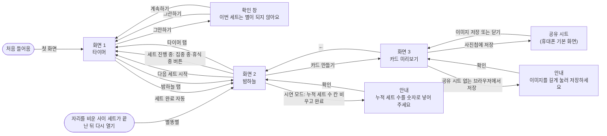
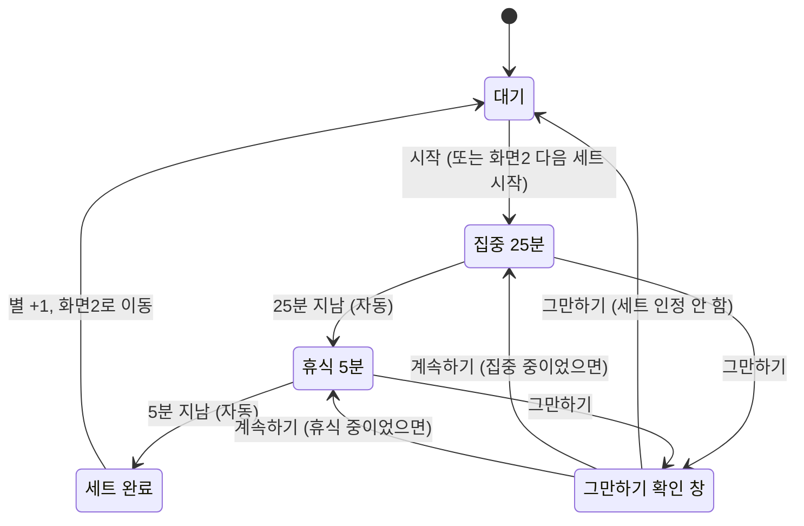

# 별도로 화면 흐름도 — 1라운드

> 1라운드(MVP 제작 교육 과정, ~2026-11-05)에서 만드는 화면만 담았습니다. 2026-09-18 topic.md의 결정(밤하늘, 합쳐지기, 25분+5분 고정, 멈추면 인정 안 함, 9:16 카드)을 바탕으로 처음 작성한 초안입니다.
>
> 와이어프레임: Byeoldoro_Wireframe.png (2026-09-19, Claude Design, wireframe-prompt.md로 생성 → wireframe-fix-prompt.md, wireframe-fix-prompt-2.md로 수정). 화면·버튼·원형 타이머·별·화살표 모두 이 문서와 맞습니다.
> - 첫 버전에서 고친 것: 별이 하나도 보이지 않던 문제(2-B, 2-C, 3-A 카드, D-1, 별 크기 범례), 3-A 카드에서 글자만 크던 배치(별이 위 2/3), 1-C → 2-B 화살표가 1-D를 가리키던 문제, 1-B·1-C → 1-D와 1-D → 1-A·1-B·1-C 화살표, 시작점 "처음 들어옴", D-1 시연 모드 메모
> - 2차로 추가한 것(2026-09-19, wireframe-fix-prompt-2.md): 1-E 대기(1세트 이상, "누적 23세트"), 2-D 세트 진행 중의 밤하늘("집중 중 · 12:30 남음"), D-1E 누적 세트 수 안내 창, 3-C 캡처 안내 카드(선택), "자리를 비운 사이 세트가 끝난 뒤 다시 열기" → 2-B 표시. 이 문서의 화면·창·안내가 모두 와이어프레임에 들어 있습니다.

## 화면 흐름

- 화면은 3개(타이머, 밤하늘, 카드 미리보기)이고, 나머지는 창과 안내입니다.
- **시작 화면은 화면1 대기 하나입니다(2026-09-19).** 그냥 주소로 들어온 사람, 테스터 링크(`…/?t=07`), 시연 링크(`…/?demo=1`) 모두 화면1 대기 상태에서 시작합니다. 0세트면 와이어프레임 1-A처럼 안내 한 줄이, 1세트 이상이면 "누적 N세트"가 보입니다.
  - **다시 열었을 때(2026-09-19 결정)**: 세트가 진행 중이면 화면1에서 남은 시간을 다시 계산해 보여주고, 자리를 비운 사이 세트가 끝났으면 화면2로 들어와 별똥별이 떨어지는 모습을 보여줍니다. 세트를 마치면 밤하늘로 자동 이동한다는 규칙과 같게 맞춘 것입니다. 그 밖에는 화면1 대기에서 시작합니다.
- **세트 완료 → 밤하늘 자동 이동**: 처음 아이디어("반복하면 두 번째 화면에 씨앗이 생긴다")대로, 세트를 마치면 밤하늘로 넘어가 새 별이 뜨는 모습을 바로 보여줍니다. 이 순간이 보상이라 버튼을 누르지 않아도 넘어가게 했습니다.
  - 넘어오면 별똥별이 떨어져 새 별 자리에 박힙니다(2026-09-19 추가).
  - 10세트, 100세트, 1000세트째에는 밤하늘에서 별 10개가 빨려 들어가듯 모여 한 단계 큰 별로 커지는 모습을 보여줍니다(화면 이동 없이 화면2 안에서 처리).
  - 화면2의 별들은 늘 은은하게 반짝입니다(2026-09-19 추가). 움직임은 화면 이동이나 버튼을 늘리지 않습니다.
- **다음 세트 시작**: 화면2에서 누르면 화면1로 가면서 곧바로 집중이 시작됩니다. 세트를 이어서 반복하게 하는 연결 버튼입니다. "타이머 탭"을 누르면 화면1로 갑니다(세트가 진행 중이면 진행 중인 화면, 아니면 대기).
- **세트 진행 중의 화면2(2026-09-19 결정)**: 세트 도중 밤하늘 탭으로 와도 타이머는 계속 돌기 때문에, "다음 세트 시작"을 그대로 두면 진행 중인데 새 세트를 시작할 수 있게 됩니다. 그래서 세트가 진행 중이면 그 자리에 "집중 중 · 12:30 남음"(휴식 중이면 "휴식 중 · 04:30 남음") 버튼을 두고, 누르면 진행 중인 화면1로 돌아갑니다. "카드 만들기"는 그대로 둡니다. 시연 모드(D-1)에서도 같습니다.
- **그만하기 확인 창**: "그만하기"를 누르면 창을 한 번 더 띄웁니다. 창에서 "그만하기"를 누르면 세트를 인정하지 않고 화면1 대기 상태로, "계속하기"를 누르면 하던 집중이나 휴식으로 돌아갑니다.
- **사진첩 저장**: 공유 시트는 우리가 만드는 화면이 아니라 휴대폰에 원래 있는 화면입니다. 아이폰에서는 여기서 "이미지 저장"을 눌러야 사진첩에 들어갑니다. 공유 시트를 열 수 없는 브라우저에서는 안내를 띄우고, 카드 이미지를 길게 눌러 저장하게 합니다.
- **로그인 화면은 없습니다(2026-09-18 결정).** 이번 교육과정에서 로그인을 다루지 않아서, 기록은 브라우저에만 저장하고 측정은 무료 분석 도구 이벤트로 합니다(scope.md "측정을 위한 최소 구현 조건"). 테스터는 번호가 붙은 개인 링크(`…/?t=07`)로 들어오고, 이 번호는 화면에 보이지 않습니다.

## 화면 1 타이머 — 상태 흐름

화면1 안에서 바뀌는 상태입니다. 화면 이동이 아니라서 위 흐름도와 따로 그렸습니다.

- **집중 → 휴식은 자동**으로 넘어갑니다. "휴식 시작" 버튼을 두면 버튼을 누르기 전까지 멈춘 상태가 생겨, 일시정지를 없앤 규칙과 어긋나기 때문입니다.
- **휴식을 건너뛰는 버튼은 없습니다.** 휴식 중 "그만하기"를 누르면 건너뛰기로 보고 세트를 인정하지 않습니다(topic.md 세트 규칙).
- **확인 창이 떠 있어도 타이머는 계속 갑니다.** 시작 시각을 기준으로 계산하므로, 창을 띄워 둔 채 시간이 다 지나면 세트가 완료됩니다.
- **세트 도중 밤하늘 탭을 눌러도 타이머는 계속 갑니다.** 화면1로 돌아오면 남은 시간이 다시 계산되어 보입니다. 탭을 닫았다가 세트 시간이 지난 뒤 돌아온 경우도 같은 규칙으로 세트를 인정합니다.

## 화면별 들어갈 요소 (와이어프레임용)

| 화면 | 요소 |
|---|---|
| 화면 1 타이머 | 지금 상태(대기/집중/휴식), 원형 타이머(한 바퀴 = 한 세트 30분, 휴식 조각 60° + 집중 조각 300°가 12시 쪽으로 줄어듦), 원 아래 작은 숫자로 지금 단계의 남은 시간, "시작"(대기일 때) 또는 "그만하기"(집중·휴식 중), 대기일 때 한 줄(0세트면 안내, 1세트 이상이면 "누적 N세트"), 아래 탭(타이머/밤하늘) |
| 확인 창 | "이번 세트는 별이 되지 않아요", "그만하기", "계속하기" |
| 화면 2 밤하늘 | 밤하늘 그림(작은별·중간별·큰별·대왕별), 누적 세트 수, 총 집중 시간, "다음 세트 시작"(세트 진행 중이면 "집중 중 · 12:30 남음" 또는 "휴식 중 · 04:30 남음"), "카드 만들기", 아래 탭(타이머/밤하늘) |
| 화면 3 카드 미리보기 | 9:16 카드 미리보기(밤하늘, 누적 세트 수, 총 집중 시간, "별도로"), "사진첩에 저장", ← |
| 안내 | "이미지를 길게 눌러 저장하세요", "확인" |

- **처음 쓰는 사람(0세트)**
  - 화면1 대기 상태에 "25분 집중하고 5분 쉬면 밤하늘에 별이 떠요" 한 줄을 보여줍니다. 따로 온보딩 화면은 만들지 않습니다. 1세트 이상이면 이 자리에 "누적 N세트"를 보여줍니다(2026-09-19 결정).
  - 화면2는 빈 밤하늘과 "첫 세트를 마치면 별이 떠요"를 보여주고, "카드 만들기"는 누를 수 없게 둡니다. 별이 없는 카드는 저장할 이유가 없기 때문입니다.

## 되돌아가는 버튼 점검

- 화면1 ↔ 화면2: 아래 탭으로 서로 오갈 수 있습니다.
- 화면3 → 화면2: ←로 돌아갑니다.
- 확인 창, 안내, 공유 시트: 모두 원래 화면으로 돌아가는 화살표가 있습니다.
- 화면3에서 화면1로 바로 가는 길은 없습니다. 카드는 밤하늘에서만 만들기 때문에 ← 한 번이면 충분하다고 봤습니다.

## 알림 (2026-09-18 결정)

- 화면이 켜져 있을 때만 소리를 냅니다. 소리가 나는 때는 두 번입니다: 집중이 끝나 휴식으로 넘어갈 때, 휴식이 끝나 세트가 완료될 때.
- 화면이 꺼져 있거나 다른 탭에 있을 때는 소리를 내지 않습니다. 다시 돌아오면 그사이 바뀐 상태(휴식 중 또는 세트 완료)를 바로 보여줍니다.
- **세트 동안 화면 켜 두기**(2026-09-19 추가): 휴대폰 화면이 자동으로 꺼지면 소리를 들을 수 없어서, 세트를 시작하면 세트가 끝날 때까지 화면이 자동으로 꺼지지 않게 합니다. 세트 완료, "그만하기", 대기 상태에서는 풀어 줍니다. 다른 앱이나 탭에 갔다가 세트 중에 돌아오면 다시 켭니다. 화면이 늘거나 버튼이 생기지는 않습니다.
- 브라우저 알림(알림 허용을 묻는 단계 필요)은 2라운드 후보로 둡니다.

## 시연 모드 (2026-09-19 결정)

- `…/?demo=1` 링크로 들어오면 세트를 짧게(집중 1분 + 휴식 12초, 실제와 같은 5:1 비율) 돌리고 누적 세트 수를 바꿔 볼 수 있습니다(scope.md "시연 모드").
- 화면은 늘지 않습니다. 화면1·2가 짧은 세트와 바꿔 넣은 누적 세트 수로 동작하고, 흐름은 위와 같습니다. 누적 세트 수를 바꾸는 입력 칸은 와이어프레임(D-1) 제안대로 밤하늘 아래, 누적 세트 수 위에 점선 박스로 둡니다. 밤하늘을 덮지 않고 하늘 높이만 조금 줄어듭니다.
- 시연 링크도 화면1 대기에서 시작합니다. 누적 세트 수를 바꾸려면 아래 탭 "밤하늘"로 화면2(D-1)에 갑니다.
- D-1의 누적 세트 수 입력 칸과 빠른 값 버튼 "9", "23", "150", "1000"은 화면 이동 없이 화면2 안에서 처리합니다(2026-09-19). 누르면 누적 세트 수, 총 집중 시간, 밤하늘의 별이 그 값으로 바로 바뀝니다(합쳐지는 연출 없이). 그 뒤 "다음 세트 시작"으로 짧은 세트를 마치면 실제처럼 별똥별과 합쳐지는 연출이 나옵니다. 예) "9"를 누르고 한 세트를 마치면 10세트째 합쳐지는 순간을 시연할 수 있습니다.
- **잘못 넣었을 때의 갈래(2026-09-19 추가)**: 누적 세트 수 칸은 숫자를 넣고 키보드의 "완료(엔터)"를 누르면 적용됩니다. 칸을 비우거나 숫자가 아닌 값(붙여넣기 등)을 넣고 "완료"를 누르면 안내("누적 세트 수를 숫자로 넣어 주세요")가 뜹니다. "확인"을 누르면 화면2(D-1)로 돌아가고, 커서가 누적 세트 수 칸에 가 있어 바로 다시 넣을 수 있습니다. 아무 반응 없이 멈추는 길은 두지 않습니다.
  - 적용 버튼을 따로 만들지 않고 키보드의 "완료"를 쓰는 이유: 와이어프레임 D-1에 버튼을 늘리지 않기 위해서입니다.
  - 이 안내 창은 와이어프레임 D-1E로 들어 있습니다(2026-09-19 2차 수정).
- 실제 사용자 화면에는 글자나 숫자를 넣는 칸이 없어서(모든 입력이 버튼 누르기), 잘못 넣을 수 있는 곳은 시연 모드의 이 칸 하나뿐입니다. 세트 도중 멈추는 "그만하기"는 잘못 넣은 것이 아니라 확인 창 갈래(1-D)로 이미 들어 있습니다.
